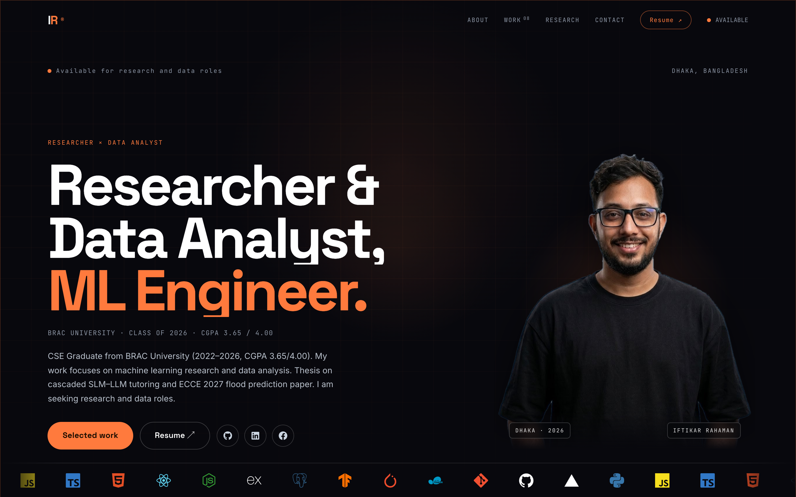
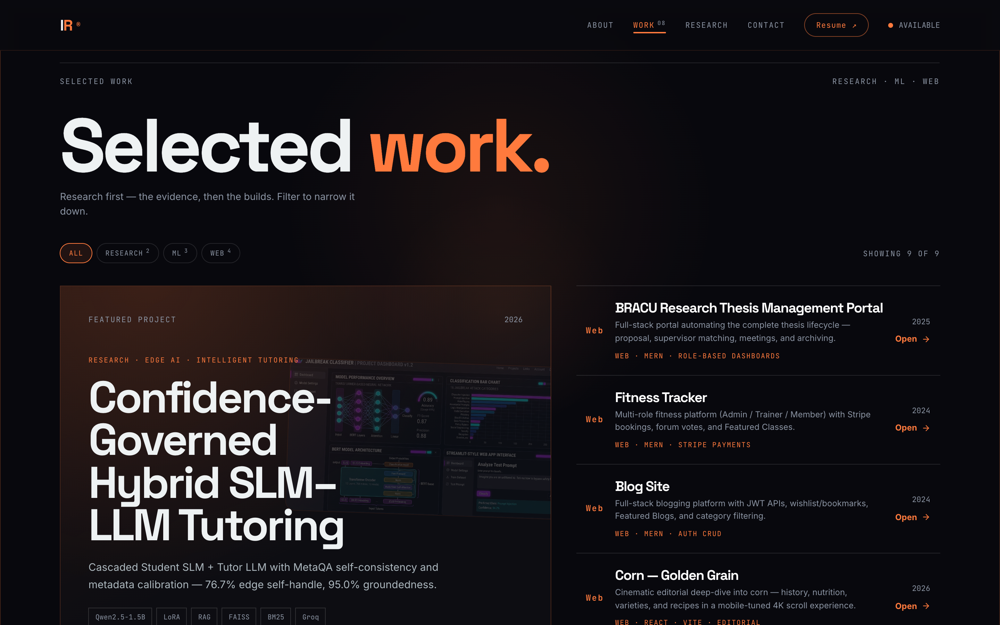
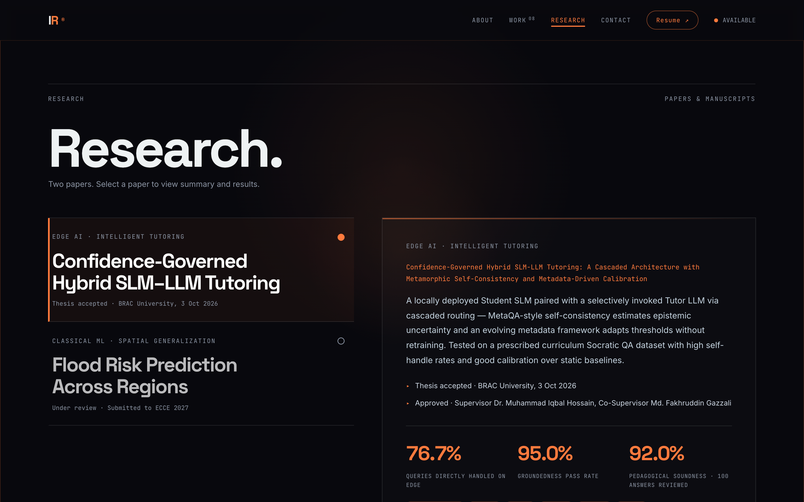
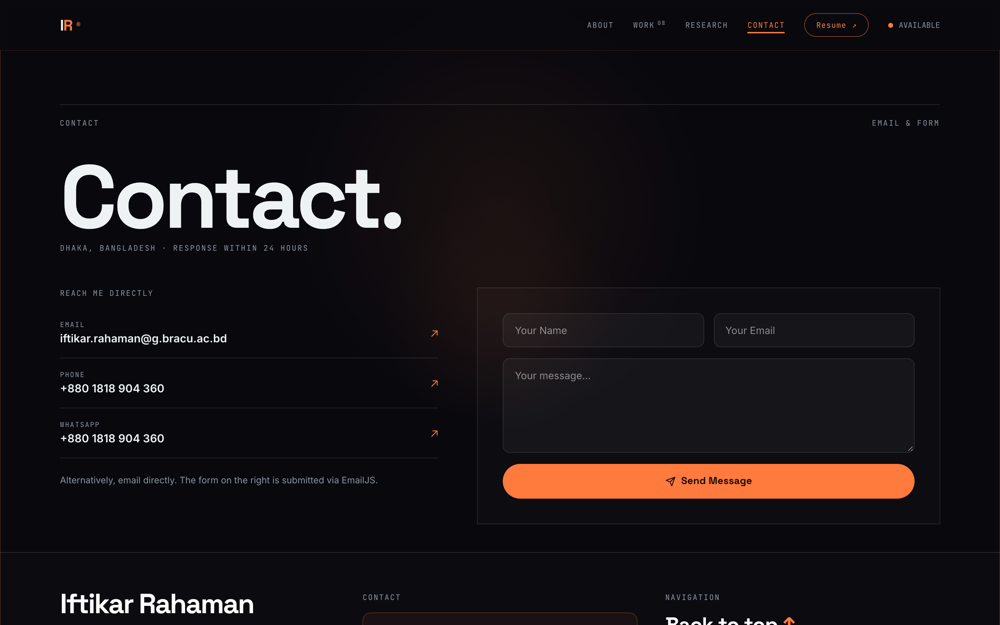

# Iftikar Rahaman — Portfolio

**Personal Engineering & AI/ML Research Portfolio**


A single-page editorial portfolio built with React, Tailwind CSS, DaisyUI, GSAP, Framer Motion, and Lenis smooth scrolling, showcasing web engineering work, deep learning projects, and academic research by Iftikar Rahaman (B.Sc. in CSE, BRAC University).

---

## Screenshots

| Hero Overview | Selected Work |
| :---: | :---: |
|  |  |

| Research Highlights | Contact Section |
| :---: | :---: |
|  |  |

---

## Core Features

- **Editorial Single-Page Architecture**: Seamless vertical flow combining `Hero`, `About`, `VideoDivider`, `Research`, `Work`, `Skills`, `Journey`, and `Contact` sections with `react-scroll` section navigation.
- **Kinetic Motion & Smooth Scrolling**: Combines `gsap`, `framer-motion`, `lenis`, and a custom `DecryptedText` effect for interactive typography and scroll choreography.
- **Project & Research Archive**: Highlights 9 curated projects spanning 4 full-stack web builds, 3 ML/CV systems, and 2 research tracks, alongside an embedded downloadable resume (`public/resume.pdf`).
- **Direct EmailJS Inquiry Form**: Client-side contact integration via `@emailjs/browser` without needing a dedicated backend server.
- **Responsive Design**: Tailwind CSS v4 + DaisyUI v5 utility styling tuned for desktop and mobile viewports.

---

## Tech Stack

| Category | Technologies |
| :--- | :--- |
| **Core UI** | React 19, React Router 7, React Scroll |
| **Styling** | Tailwind CSS 4.1 (`@tailwindcss/vite`), DaisyUI 5.0, React Icons |
| **Animation** | GSAP 3.15, Framer Motion 12.23, Lenis 1.3 |
| **Communication** | EmailJS (`@emailjs/browser`) |
| **Tooling & Hosting** | Vite 7.1, ESLint 9, Netlify (`netlify.toml`) |

---

## Project Structure

```text
Portfolio/
├── public/
│   ├── resume.pdf               # Downloadable CV asset
│   └── ...                      # Project previews & profile imagery
├── src/
│   ├── components/
│   │   ├── DecryptedText.jsx    # Kinetic text scramble component
│   │   ├── Footer.jsx
│   │   ├── Hero.jsx
│   │   ├── Navbar.jsx
│   │   └── VideoDivider.jsx
│   ├── data/
│   │   └── profile.js           # Structured profile, projects & timeline data
│   ├── layouts/
│   │   └── RootLayout.jsx
│   ├── pages/
│   │   ├── About.jsx
│   │   ├── Contact.jsx
│   │   ├── Home.jsx             # Composed single-page editorial view
│   │   ├── Journey.jsx
│   │   ├── Research.jsx
│   │   ├── Skills.jsx
│   │   └── Work.jsx
│   ├── routers/
│   │   └── router.jsx
│   ├── App.jsx
│   └── main.jsx
├── netlify.toml
└── package.json
```

---

## Local Setup

### Prerequisites

- Node.js 18+
- npm

### Installation & Run

```bash
git clone https://github.com/IFTI-KAR/Portfolio.git
cd Portfolio

# Install dependencies
npm install

# Start Vite development server (http://localhost:5173)
npm run dev

# Build production bundle
npm run build
```
